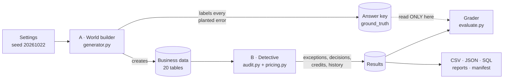
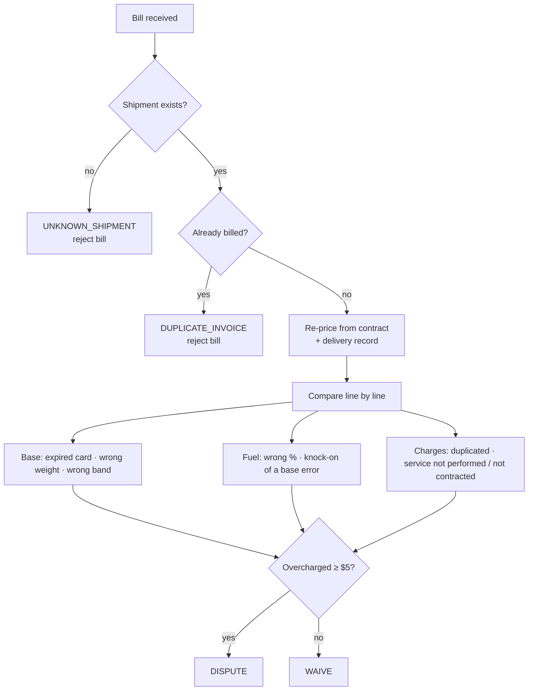
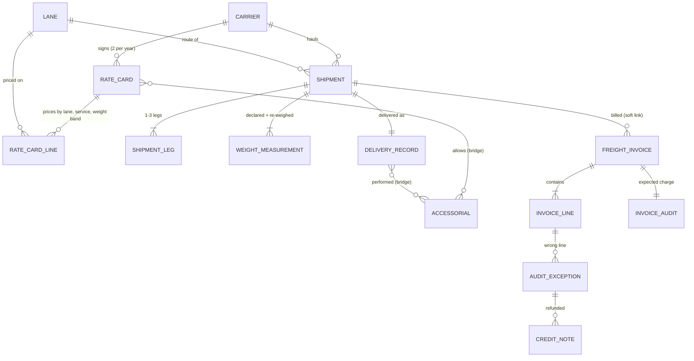

# Freight Invoice Audit

**Automatically check carrier freight bills against contracted rates, measured shipment
weight and size, extra services (accessorials) and delivery records. Explain every
overcharge line by line, dispute it, and make sure the refund matches what was agreed.**

   

| Bills audited | Planted errors found | False alarms | Money recovered or never paid | Data checks | Run time |
|:---:|:---:|:---:|:---:|:---:|:---:|
| 15,000 | **2,282 / 2,282** | **0** | **$254,004** (3.8% of $6.74M) | **168 / 168** | ~20 s |

*All data is synthetic and generated with a fixed seed, so these numbers are exactly reproducible.*

---

## Contents

1. [The problem](#the-problem)
2. [The solution](#the-solution)
3. [How to run](#how-to-run)
4. [What you get](#what-you-get)
5. [How it works](#how-it-works)
6. [Data model](#data-model)
7. [Proving it works](#proving-it-works)
8. [Project structure](#project-structure)
9. [Design decisions and trade-offs](#design-decisions-and-trade-offs)
10. [Limitations and next steps](#limitations-and-next-steps)
11. [Data provenance](#data-provenance)

---

## The problem

A company ships goods through trucking companies (**carriers**). Each carrier signs a
**rate card**: prices per route (lane), service level and weight band, valid for a fixed
period. After delivery the carrier sends a **freight invoice**:

- **base freight:** billable weight × rate
- **fuel surcharge:** a % of the base
- **accessorials:** extra services such as a liftgate or waiting time

Bills are often wrong, almost always in the carrier's favour:

| Mistake | Example |
|---|---|
| Bill for a shipment that doesn't exist | Quotes `SHP-2026-961912`; no such shipment |
| Same bill sent twice | Identical bill arrives a month later |
| Expired rate card | July shipment priced on the January–June contract |
| Wrong weight band | 664 lb charged at the 0–499 lb rate |
| Inflated size-based (DIM) weight | Billed 2,407 lb; measurements support 1,660 lb |
| Wrong fuel surcharge | 33.5% instead of the contracted 28.5% |
| Surcharge duplicated | Fuel line appears twice |
| Invalid accessorial | Liftgate billed but not used, or not in the contract |
| Refund larger than agreed | $32.58 credited against $28.83 approved |

Checking thousands of bills by hand doesn't scale.

## The solution

There is no real company data, so the project has **two independent halves** and a
grader between them. That makes the solution measurable.



| Part | Does | Never |
|---|---|---|
| **World builder** | Creates carriers, contracts, shipments, deliveries and bills. Most bills are correct; some are broken on purpose, and each break is written to the answer key | — |
| **Detective (audit engine)** | Re-prices every bill line from the contract and the delivery record, raises an explained exception for each wrong line, disputes, and reconciles refunds | Never reads the answer key (a test checks this) |
| **Grader** | Compares the detective's findings with the answer key: precision, recall, F1, decision and $ accuracy | — |

---

## How to run

**Requirements:** Python **3.10 or newer**. The core needs nothing else. The dashboard needs
`pandas`, `streamlit` and `altair` (installed from `requirements.txt`).

```bash
git clone https://github.com/AashishTetali/freight-invoice-audit.git
cd freight-invoice-audit
```

### Option A: one complete run (Windows)

Double-click **`run_all.bat`**, or run it from a terminal in the project folder:

```bat
run_all.bat
```

It runs these four steps in order (about 4 minutes) and stops if any step fails:

1. installs the dashboard libraries
2. runs all 102 automated tests
3. builds the **starter** and **full** datasets, each checked twice for reproducibility
4. opens the dashboard in your browser (press `Ctrl+C` in the window to stop it)

### Option B: step by step (any OS)

```bash
pip install -r requirements.txt                    # only needed for the dashboard

python -m unittest                                 # 102 tests, ~15 s
python -m freight_audit run --scale starter        # small dataset, ~2 s
python -m freight_audit run --scale full           # full dataset, ~20 s
python -m freight_audit reproduce --scale full     # build twice, compare SHA-256 of every file
python -m freight_audit all                        # both datasets + both reproducibility checks
streamlit run dashboard/app.py                     # dashboard (run a dataset first)
```

### Commands and options

| Command | Does |
|---|---|
| `python -m freight_audit run --scale starter\|full` | Generate, audit, validate, score and export one dataset |
| `python -m freight_audit reproduce --scale starter\|full` | Build twice from scratch; confirm every file is byte-identical |
| `python -m freight_audit all` | `run` + `reproduce` for both datasets |
| `--seed N` | Different seed, different (but still reproducible) world. Default `20261022` |
| `--out FOLDER` | Where to write results. Default `output/` |

The exit code is `0` when every check passes and `1` when anything fails.

| Dataset | Carriers | Shipments | Bills | Planted errors | Time |
|---|---:|---:|---:|---:|---:|
| `starter` | 10 | 1,000 | 750 | 107 | ~2 s |
| `full` (the brief's size) | 100 | 20,000 | 15,000 | 2,282 | ~20 s |

### What you should see

```
  Validation : PASS (168/168 checks passed)
  Detection  : precision 100.0%, recall 100.0% (2282 of 2282 planted problems found)
  Money      : billed $6,740,996.96, saved $254,004.48
  Reproducibility (full): 48 files compared twice -> IDENTICAL
```

Then open **`output/full/reports/summary.md`**, a one-page plain-English summary of the run.

---

## What you get

Every run writes `output/<scale>/`. A copy of the generated results for both datasets is committed under `output/` so you can browse them without running anything; running the program again recreates byte-identical files (`reproduce` verifies this).

```
output/full/
├── data/
│   ├── csv/      20 tables as CSV
│   ├── json/     the same 20 tables as JSON
│   └── sql/      schema.sql (CREATE TABLE with keys + checks), seed.sql (INSERTs)
├── ground_truth/ ground_truth.csv / .json     the answer key, kept OUTSIDE data/
├── reports/
│   ├── summary.md               plain-English results  ← read this first
│   ├── validation_summary.json  every data-quality check: PASS/FAIL, counts, examples
│   ├── audit_metrics.json       precision / recall / F1 per error type, $ results, carrier ranking
│   └── reproducibility.json     SHA-256 of every file from two independent runs
├── manifest.json                every file with row count + SHA-256, seed, command, provenance
└── DATA_DICTIONARY.md           every table and column: type, required, allowed values, units, rules
```

**The dashboard** (`streamlit run dashboard/app.py`) reads these files and shows six tabs:
overview, exceptions, invoice explorer (each bill line next to its verdict, refunds and full
history), carriers, detection scorecard and data quality. Charts are fixed and show the
value when you hover a bar.

---

## How it works

### 1. What a shipment should cost (`pricing.py`)

| Step | Rule |
|---|---|
| Measurement | The latest **carrier re-weigh** if there is one; otherwise the shipper's declaration |
| DIM weight | `ceil(length × width × height × pieces ÷ dim_factor)` (factor 139 or 166, per contract) |
| Billable weight | `max(ceil(actual weight), DIM weight)` |
| Rate card | The carrier's card whose dates contain the **ship date** |
| Base | `max(billable weight × band rate, minimum charge)` |
| Fuel | `base × fuel %` |
| Accessorials | Only if on the **delivery record** *and* in the **contract**; detention above 2 free hours |

Money uses exact `Decimal`, rounded half-up to cents.

**Worked example:** a 48×40×48 in pallet weighing 300 lb → DIM 92,160 ÷ 139 = 663.02 → **664 lb**
→ 500–999 lb band at $0.18 → base **$119.52** + fuel 22% **$26.29** + liftgate **$50** = **$195.81**.

### 2. How each bill is audited (`audit.py`)



Every exception records the exact `line_id`, the reason, and **expected, billed and variance**
amounts. A fuel error caused only by a wrong base is linked to its root cause, so nothing is
counted twice. For every bill: **billed − expected = sum of its exception variances**, to the cent.

### 3. Disputes and refunds

| Situation | Outcome |
|---|---|
| Fake or duplicate bill | Invoice **REJECTED**, nothing paid |
| Overcharged by ≥ $5 | **DISPUTED** (approved amount = the overcharge) |
| Overcharged by < $5 | **WAIVED** (not worth the paperwork) |
| No exceptions | **APPROVED**, then **PAID** on 30-day terms |
| Carrier refunds the full amount | Exception **CREDITED** → invoice **RESOLVED** → **PAID** (net of credits) |
| Partial refund, refusal, or refund **larger** than approved | Over-refund **HELD** + a new `CREDIT_EXCEEDS_EXCEPTION`; invoice **ESCALATED** |

### 4. Who does what

Every status change is a **new history row** (never overwritten) that records who made it.

| Role | Creates |
|---|---|
| Supplier | Weight and size declaration (bill of lading) |
| Planner | Shipment **BOOKED** |
| Carrier | Pick-up, transit, re-weigh, invoice **RECEIVED**, credit notes |
| Warehouse operator | Delivery record and the services actually used |
| Audit engine | **AUDITED**, exceptions, applies or holds refunds |
| Logistics analyst | Disputes, waives, resolves or escalates |
| Operations manager | Releases payment (**PAID**) and handles escalations |

---

## Data model

20 business tables (the 11 required entities + 9 supporting ones) plus the answer key,
all defined once in [`freight_audit/schema.py`](freight_audit/schema.py). Every run also writes
the full data dictionary.



| Domain | Tables | Rows (full) |
|---|---|---:|
| Contracts | carrier, lane, rate_card, rate_card_line, accessorial, rate_card_accessorial | 21,115 |
| Operations | shipment, shipment_leg, weight_measurement, delivery_record, delivery_accessorial, shipment_status_history | 186,156 |
| Billing | freight_invoice, invoice_line, invoice_status_history, invoice_audit | 131,546 |
| Audit and refunds | audit_exception, exception_status_history, credit_note, credit_note_status_history | 19,375 |

**IDs** follow the brief and are zero-padded and immutable: `CAR-000001`,
`RATE-CAR-000001-2026-01`, `SHP-2026-000001`, `FINV-2026-000001`,
`FLINE-FINV-2026-000001-01`, `FEX-2026-000001`.

The bill's shipment number (`shipment_ref`) is deliberately **not** a foreign key. It's untrusted
carrier input; the audit validates it, which is how bills for non-existent shipments are caught.

---

## Proving it works

| Layer | What | Result |
|---|---|---|
| **Data validation** | 168 checks: primary and foreign keys, allowed values, ID formats, date order, arithmetic, lifecycles, duplicates, no answer-key leakage | 168 / 168 PASS |
| **Grading** | Detective vs answer key: precision, recall, F1 per error type, decision and $ accuracy, false alarms on correct bills | 100% / 100%, 0 false alarms |
| **Reproducibility** | Build twice from scratch, compare SHA-256 of 48 files | Identical |
| **Unit tests** (81) | Core logic: every audit rule (break one line of a correct bill → exactly the right exception), the error generator, the pricing maths, every validation check | Pass |
| **Integration tests** (21) | Whole system: exact starter results, the command line as a real process, traceability, negative scenarios | Pass |

```bash
python -m unittest -v                                   # all 102
python -m unittest discover -s tests/unit -t .          # unit only
python -m unittest discover -s tests/integration -t .   # integration only
```

**About the 100% scores.** The world and the detective share the written contract rules, so a
perfect score shows the code is **correct and consistent**, not that real-world audits are
perfect. The negative-scenario tests show the scores do move:
- A too-lenient detective drops recall to 78.5%.
- A wrong contract value drops precision to 55.4%.
- Corrupted data fails validation, and the failing checks name the exact records.

---

## Project structure

```
freight_audit/
├── __main__.py     command line: run / reproduce / all
├── pipeline.py     the conductor: runs every step in order; reproducibility check
├── config.py       every setting: sizes, seed, error rates, thresholds
├── schema.py       the 20 tables, keys, allowed values, lifecycles → SQL, checks, dictionary
├── reference.py    world facts: cities, weight bands, service prices
├── pricing.py      contract maths (what a shipment should cost)
├── generator.py    A · world builder: master data → shipments → bills, planted errors
├── audit.py        B · detective: audit, dispute rules, refund reconciliation
├── settlement.py   simulated carrier replies to disputes
├── history.py      append-only status history
├── validate.py     data-quality checks
├── evaluate.py     grading + business metrics
└── export.py       CSV / JSON / SQL / data dictionary / manifest
dashboard/app.py    Streamlit dashboard
tests/
├── helpers.py      small fresh worlds for tests
├── unit/           audit, generator, pricing, validate
└── integration/    whole-system tests
output/             generated results for both datasets (data, answer key, reports, manifest)
run_all.bat         one complete run (Windows)
requirements.txt    dashboard libraries
```

---

## Design decisions and trade-offs

| Decision | Why | Trade-off |
|---|---|---|
| **Written contract rules decide every amount** (no ML or LLM in decisions) | A dispute must be explainable line by line and give the same answer every time | Can't find error types nobody wrote a rule for |
| **Two halves + a separate answer key** | No real data exists, yet the results must be measurable | The score proves correctness, not real-world accuracy |
| **One schema drives the SQL, checks and docs** | They can never disagree | A small custom framework to learn |
| **Append-only history** | "Never overwrite history"; a full audit trail | More rows to store |
| **Exact `Decimal` money** | Totals reconcile to the cent | Slightly more verbose than floats |
| **Seeded random streams, no timestamps in outputs** | Byte-identical results on every run | The run time lives in git, not in the files |
| **One planted error per bill**, more for "sloppy" carriers | Unambiguous scoring, realistic bad carriers | Less realistic than multi-error bills |
| **Knock-on exceptions linked to their root** | Every dollar explained, nothing double-counted | Slightly more complex rules |
| **Standard library only** | Runs anywhere with no setup | Not production scale |

---

## Limitations and next steps

**Limitations**
- All data is synthetic, so the dollar figures show capability, not measured savings.
- One planted error per bill; a single currency (USD).
- The duplicate rule keeps the earliest bill; there's no "corrected re-bill" workflow.
- Everything runs in memory in one process. That's fine for 358k rows, but not for hundreds of millions.

**Scaling path**
1. Postgres or a data warehouse instead of in-memory tables (the generated SQL is ANSI-style).
2. Stateless audit workers partitioned by carrier and month, fed by a queue, with idempotent processing.
3. Real inputs: EDI 210 invoices and PDFs (OCR or extraction, checked against the source).
4. An analyst work queue with approvals, and carrier scorecards for contract negotiations.
5. A read-only assistant that explains exceptions from the audit records, never making decisions itself.

---

## Data provenance

100% synthetic. No external datasets were downloaded, and there is no personal or confidential
data. Carrier names and SCAC codes are invented. City coordinates are approximate public
geographic facts, typed in by hand and used only to estimate distances. Every run's
`manifest.json` records the seed, the command and this provenance statement.


