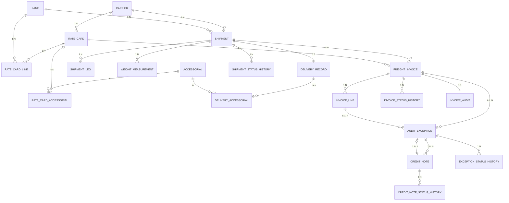

# Data dictionary

Generated from `freight_audit/schema.py` (the same definitions create the SQL schema and drive the validation checks). Money is in USD with 2 decimals, weights in pounds (lb), dimensions in inches, dates are ISO `YYYY-MM-DD`.

## ID conventions

| Entity | Format | Example |
|---|---|---|
| Carrier | `CAR-` + 6 digits | CAR-000001 |
| Rate card | `RATE-<carrier-id>-<year>-<version>` | RATE-CAR-000001-2026-01 |
| Shipment | `SHP-<year>-` + 6 digits | SHP-2026-000001 |
| Freight invoice | `FINV-<year>-` + 6 digits | FINV-2026-000001 |
| Invoice line | `FLINE-<invoice-id>-` + 2 digits | FLINE-FINV-2026-000001-01 |
| Audit exception | `FEX-<year>-` + 6 digits | FEX-2026-000001 |
| Credit note | `CN-<year>-` + 6 digits | CN-2026-000001 |
| Others | LANE-000001, RLN-000001, WM-2026-000001, DLV-2026-000001, <shipment-id>-L1, SEV/IEV/EEV/CEV-0000001 (history events), GT-000001 | |

IDs are zero-padded, never re-used and never changed.

## Entity-relationship diagram

## Relationships and cardinality

| Parent | Child | Cardinality / notes |
|---|---|---|
| carrier | rate_card | 1:N - a carrier has one card per period (2 in 2026) |
| rate_card | rate_card | 1:0..1 - a card may replace a previous card |
| rate_card | rate_card_line | 1:N - many lane/service/tier prices per card |
| lane | rate_card_line | 1:N |
| rate_card | accessorial | N:M via rate_card_accessorial |
| carrier | shipment | 1:N |
| lane | shipment | 1:N |
| shipment | shipment_leg | 1:N (1-3 legs) |
| shipment | weight_measurement | 1:N (shipper BOL + optional carrier re-weigh) |
| shipment | delivery_record | 1:1 |
| delivery_record | accessorial | N:M via delivery_accessorial |
| shipment | shipment_status_history | 1:N |
| shipment | freight_invoice | 1:N by shipment_ref (normally 1; 2+ = duplicate billing). Soft link, validated by the audit |
| rate_card | freight_invoice | 1:N |
| freight_invoice | invoice_line | 1:N |
| freight_invoice | invoice_status_history | 1:N |
| freight_invoice | invoice_audit | 1:1 |
| freight_invoice | audit_exception | 1:0..N |
| invoice_line | audit_exception | 1:0..N (optional: invoice-level exceptions have no line) |
| audit_exception | audit_exception | 1:0..N knock-on exceptions via root_exception_id |
| audit_exception | credit_note | 1:0..N (optional: only disputed exceptions get credits) |
| credit_note | audit_exception | 1:0..1 a bad credit raises its own exception |
| audit_exception | exception_status_history | 1:N |
| credit_note | credit_note_status_history | 1:N |

## Lifecycle states

Status changes are stored as new rows in the `*_status_history` tables; `current_status` is a convenience copy of the latest event.

* **shipment**: (new) -> BOOKED; BOOKED -> PICKED_UP; PICKED_UP -> IN_TRANSIT; IN_TRANSIT -> DELIVERED
* **invoice**: (new) -> RECEIVED; RECEIVED -> AUDITED; AUDITED -> APPROVED / DISPUTED / REJECTED; APPROVED -> PAID; DISPUTED -> ESCALATED / RESOLVED; RESOLVED -> PAID
* **exception**: (new) -> OPEN; OPEN -> ACKNOWLEDGED / DISPUTED / INVOICE_REJECTED / WAIVED; DISPUTED -> CARRIER_DECLINED / CREDITED / CREDIT_ON_HOLD / PARTIALLY_CREDITED
* **credit_note**: (new) -> ISSUED; ISSUED -> APPLIED / HELD

## `carrier` (master)

A trucking company that moves freight for us.

Primary key: `carrier_id`

| Column | Type | Required | Allowed values / format | Unit | Unique | References | Description and rule |
|---|---|---|---|---|---|---|---|
| carrier_id | TEXT | yes | `^CAR-\d{6}$` |  | yes |  | Carrier identifier |
| carrier_name | TEXT | yes |  |  | yes |  | Trading name (fictional) |
| scac_code | TEXT | yes | `^[A-Z]{4}$` |  | yes |  | 4-letter Standard Carrier Alpha Code (fictional) |
| hq_state | TEXT | yes | `^[A-Z]{2}$` |  |  |  | US state of head office |
| onboarded_date | DATE | yes |  |  |  |  | Date the carrier was approved to haul for us. Rule: before the first rate card starts |
| status | TEXT | yes | ACTIVE, INACTIVE |  |  |  | Carrier status |

## `lane` (master)

A route from an origin city to a destination city.

Primary key: `lane_id`. Also unique: (origin_city, origin_state, dest_city, dest_state)

| Column | Type | Required | Allowed values / format | Unit | Unique | References | Description and rule |
|---|---|---|---|---|---|---|---|
| lane_id | TEXT | yes | `^LANE-\d{6}$` |  | yes |  | Lane identifier |
| origin_city | TEXT | yes |  |  |  |  | Origin city |
| origin_state | TEXT | yes | `^[A-Z]{2}$` |  |  |  | Origin state |
| dest_city | TEXT | yes |  |  |  |  | Destination city. Rule: differs from origin_city |
| dest_state | TEXT | yes | `^[A-Z]{2}$` |  |  |  | Destination state |
| distance_miles | INTEGER | yes |  | miles |  |  | Road distance estimate. Rule: > 0 |

## `rate_card` (master)

A carrier's contracted price list for one period. Version 01 = Jan-Jun, 02 = Jul-Dec.

Primary key: `rate_card_id`. Also unique: (carrier_id, version)

| Column | Type | Required | Allowed values / format | Unit | Unique | References | Description and rule |
|---|---|---|---|---|---|---|---|
| rate_card_id | TEXT | yes | `^RATE-CAR-\d{6}-\d{4}-\d{2}$` |  | yes |  | Rate card identifier: RATE-<carrier-id>-<year>-<version> |
| carrier_id | TEXT | yes |  |  |  | carrier.carrier_id | Carrier that owns this contract |
| version | TEXT | yes | 2026-01, 2026-02 |  |  |  | Period version within the year |
| effective_from | DATE | yes |  |  |  |  | First day the card is valid |
| effective_to | DATE | yes |  |  |  |  | Last day the card is valid. Rule: >= effective_from |
| previous_rate_card_id | TEXT | no |  |  |  | rate_card.rate_card_id | The card this one replaced |
| currency | TEXT | yes | USD |  |  |  | Currency of all amounts |
| min_charge | DECIMAL(12,2) | yes |  | USD |  |  | Lowest base charge for any shipment. Rule: > 0 |
| fuel_surcharge_pct | DECIMAL(5,2) | yes |  | % |  |  | Fuel surcharge as % of base freight. Rule: 0 < pct < 50 |
| dim_factor | INTEGER | yes | 139, 166 | cubic inches per lb |  |  | Divisor for dimensional weight |
| status | TEXT | yes | ACTIVE, EXPIRED |  |  |  | Status on the as-of date (derived from effective dates) |

## `rate_card_line` (master)

One price on a rate card: lane + service level + weight tier -> $ per lb.

Primary key: `rate_line_id`. Also unique: (rate_card_id, lane_id, service_level, tier_min_lb)

| Column | Type | Required | Allowed values / format | Unit | Unique | References | Description and rule |
|---|---|---|---|---|---|---|---|
| rate_line_id | TEXT | yes | `^RLN-\d{6}$` |  | yes |  | Rate line identifier |
| rate_card_id | TEXT | yes |  |  |  | rate_card.rate_card_id | Parent rate card |
| lane_id | TEXT | yes |  |  |  | lane.lane_id | Lane this price applies to |
| service_level | TEXT | yes | ECONOMY, STANDARD, EXPEDITED |  |  |  | Service level |
| tier_min_lb | INTEGER | yes |  | lb |  |  | Lowest billable weight in this tier (inclusive) |
| tier_max_lb | INTEGER | no |  | lb |  |  | Highest billable weight in this tier (inclusive); empty = no limit. Rule: > tier_min_lb |
| rate_per_lb | DECIMAL(10,4) | yes |  | USD/lb |  |  | Price per billable pound. Rule: decreases as tiers get heavier |

## `accessorial` (master)

Catalogue of extra services a carrier can charge for.

Primary key: `accessorial_code`

| Column | Type | Required | Allowed values / format | Unit | Unique | References | Description and rule |
|---|---|---|---|---|---|---|---|
| accessorial_code | TEXT | yes | LIFTGATE, RESIDENTIAL, INSIDE_DELIVERY, APPOINTMENT, LIMITED_ACCESS, HAZMAT, DETENTION |  | yes |  | Accessorial code |
| description | TEXT | yes |  |  |  |  | What the service is |
| charge_basis | TEXT | yes | FLAT, PER_HOUR |  |  |  | How it is charged |
| reference_amount | DECIMAL(12,2) | yes |  | USD |  |  | Typical market price (contracts may differ) |

## `rate_card_accessorial` (bridge)

Bridge (N:M): which accessorials each rate card allows, at what price.

Primary key: `rate_card_id, accessorial_code`

| Column | Type | Required | Allowed values / format | Unit | Unique | References | Description and rule |
|---|---|---|---|---|---|---|---|
| rate_card_id | TEXT | yes |  |  |  | rate_card.rate_card_id | Rate card |
| accessorial_code | TEXT | yes |  |  |  | accessorial.accessorial_code | Accessorial allowed by the contract |
| contracted_amount | DECIMAL(12,2) | yes |  | USD |  |  | Contract price per unit (each or per hour) |

## `shipment` (transaction)

One booking to move goods from origin to destination.

Primary key: `shipment_id`

| Column | Type | Required | Allowed values / format | Unit | Unique | References | Description and rule |
|---|---|---|---|---|---|---|---|
| shipment_id | TEXT | yes | `^SHP-\d{4}-\d{6}$` |  | yes |  | Shipment identifier |
| carrier_id | TEXT | yes |  |  |  | carrier.carrier_id | Carrier hauling it |
| lane_id | TEXT | yes |  |  |  | lane.lane_id | Lane. Rule: carrier has a rate on this lane+service |
| service_level | TEXT | yes | ECONOMY, STANDARD, EXPEDITED |  |  |  | Service level booked |
| ship_date | DATE | yes |  |  |  |  | Pick-up date |
| planned_delivery_date | DATE | yes |  |  |  |  | Promised delivery date. Rule: >= ship_date |
| pieces | INTEGER | yes |  |  |  |  | Number of handling units (pallets/crates). Rule: 1..6 |
| current_status | TEXT | yes | BOOKED, PICKED_UP, IN_TRANSIT, DELIVERED |  |  |  | Latest status (derived from shipment_status_history) |

## `shipment_leg` (transaction)

One segment of a shipment's journey (direct = 1 leg, via a hub = 2-3 legs).

Primary key: `leg_id`. Also unique: (shipment_id, leg_seq)

| Column | Type | Required | Allowed values / format | Unit | Unique | References | Description and rule |
|---|---|---|---|---|---|---|---|
| leg_id | TEXT | yes | `^SHP-\d{4}-\d{6}-L\d$` |  | yes |  | Leg identifier: <shipment-id>-L<n> |
| shipment_id | TEXT | yes |  |  |  | shipment.shipment_id | Parent shipment |
| leg_seq | INTEGER | yes |  |  |  |  | Order of the leg, starting at 1 |
| origin_city | TEXT | yes |  |  |  |  | Leg start city. Rule: leg 1 starts at the lane origin |
| origin_state | TEXT | yes |  |  |  |  | Leg start state |
| dest_city | TEXT | yes |  |  |  |  | Leg end city. Rule: last leg ends at the lane destination |
| dest_state | TEXT | yes |  |  |  |  | Leg end state |
| leg_miles | INTEGER | yes |  | miles |  |  | Leg distance |
| depart_date | DATE | yes |  |  |  |  | Leg departure. Rule: >= previous leg arrival |
| arrive_date | DATE | yes |  |  |  |  | Leg arrival. Rule: >= depart_date |

## `weight_measurement` (transaction)

A weighing/measuring of a shipment. Shipper declares it; carriers sometimes re-weigh. Rule: the latest CARRIER_REWEIGH wins, otherwise the SHIPPER_BOL.

Primary key: `measurement_id`

| Column | Type | Required | Allowed values / format | Unit | Unique | References | Description and rule |
|---|---|---|---|---|---|---|---|
| measurement_id | TEXT | yes | `^WM-\d{4}-\d{6}$` |  | yes |  | Measurement identifier |
| shipment_id | TEXT | yes |  |  |  | shipment.shipment_id | Shipment measured |
| measurement_source | TEXT | yes | SHIPPER_BOL, CARRIER_REWEIGH |  |  |  | Who produced it |
| measured_by_role | TEXT | yes | SUPPLIER, PLANNER, CARRIER, WAREHOUSE_OPERATOR, AUDIT_ENGINE, LOGISTICS_ANALYST, OPERATIONS_MANAGER |  |  |  | Actor role |
| measured_date | DATE | yes |  |  |  |  | Date measured. Rule: >= ship_date |
| pieces | INTEGER | yes |  |  |  |  | Handling units counted |
| length_in | INTEGER | yes |  | inches |  |  | Length of one piece |
| width_in | INTEGER | yes |  | inches |  |  | Width of one piece |
| height_in | INTEGER | yes |  | inches |  |  | Height of one piece |
| actual_weight_lb | DECIMAL(10,1) | yes |  | lb |  |  | Scale weight of the whole shipment. Rule: > 0 |

## `delivery_record` (transaction)

Proof of delivery: what actually happened at drop-off.

Primary key: `delivery_id`

| Column | Type | Required | Allowed values / format | Unit | Unique | References | Description and rule |
|---|---|---|---|---|---|---|---|
| delivery_id | TEXT | yes | `^DLV-\d{4}-\d{6}$` |  | yes |  | Delivery identifier |
| shipment_id | TEXT | yes |  |  | yes | shipment.shipment_id | Shipment delivered (1:1) |
| delivered_date | DATE | yes |  |  |  |  | Actual delivery date. Rule: = last leg arrival |
| delivery_outcome | TEXT | yes | ON_TIME, LATE |  |  |  | ON_TIME if delivered_date <= planned_delivery_date |
| wait_hours | DECIMAL(5,2) | yes |  | hours |  |  | Hours the driver waited at delivery. Rule: detention billable above 2 free hours |
| recorded_by_role | TEXT | yes | SUPPLIER, PLANNER, CARRIER, WAREHOUSE_OPERATOR, AUDIT_ENGINE, LOGISTICS_ANALYST, OPERATIONS_MANAGER |  |  |  | Actor role |

## `delivery_accessorial` (bridge)

Bridge (N:M): extra services actually performed at delivery.

Primary key: `delivery_id, accessorial_code`

| Column | Type | Required | Allowed values / format | Unit | Unique | References | Description and rule |
|---|---|---|---|---|---|---|---|
| delivery_id | TEXT | yes |  |  |  | delivery_record.delivery_id | Delivery record |
| accessorial_code | TEXT | yes |  |  |  | accessorial.accessorial_code | Service performed. Rule: must be allowed by the shipment's rate card |
| quantity | DECIMAL(5,2) | yes |  |  |  |  | Units performed (1 for flat services, hours for detention) |

## `shipment_status_history` (event)

Every status change of a shipment (never overwritten).

Primary key: `event_id`

| Column | Type | Required | Allowed values / format | Unit | Unique | References | Description and rule |
|---|---|---|---|---|---|---|---|
| event_id | TEXT | yes | `^SEV-\d{7}$` |  | yes |  | Event identifier |
| shipment_id | TEXT | yes |  |  |  | shipment.shipment_id | Shipment |
| from_status | TEXT | no | BOOKED, PICKED_UP, IN_TRANSIT, DELIVERED |  |  |  | Previous status (empty for the first event) |
| to_status | TEXT | yes | BOOKED, PICKED_UP, IN_TRANSIT, DELIVERED |  |  |  | New status |
| event_date | DATE | yes |  |  |  |  | When it changed. Rule: non-decreasing per shipment |
| actor_role | TEXT | yes | SUPPLIER, PLANNER, CARRIER, WAREHOUSE_OPERATOR, AUDIT_ENGINE, LOGISTICS_ANALYST, OPERATIONS_MANAGER |  |  |  | Who changed it |

## `freight_invoice` (transaction)

A carrier's bill. Values are exactly what the carrier submitted (untrusted input).

Primary key: `invoice_id`

| Column | Type | Required | Allowed values / format | Unit | Unique | References | Description and rule |
|---|---|---|---|---|---|---|---|
| invoice_id | TEXT | yes | `^FINV-\d{4}-\d{6}$` |  | yes |  | Invoice identifier |
| carrier_id | TEXT | yes |  |  |  | carrier.carrier_id | Carrier that sent the bill |
| shipment_ref | TEXT | yes | `^SHP-\d{4}-\d{6}$` |  |  |  | Shipment number written on the bill. Deliberately NOT a foreign key: it is untrusted carrier input and the audit checks it |
| rate_card_id | TEXT | yes |  |  |  | rate_card.rate_card_id | Rate card the carrier says it used |
| invoice_date | DATE | yes |  |  |  |  | Bill date. Rule: >= delivered_date |
| billed_weight_lb | INTEGER | yes |  | lb |  |  | Weight the carrier charged for |
| total_billed | DECIMAL(12,2) | yes |  | USD |  |  | Invoice total. Rule: = sum of its lines |
| currency | TEXT | yes | USD |  |  |  | Currency |
| current_status | TEXT | yes | RECEIVED, AUDITED, APPROVED, DISPUTED, REJECTED, RESOLVED, ESCALATED, PAID |  |  |  | Latest status (derived from invoice_status_history) |

## `invoice_line` (transaction)

One charge row on a carrier invoice.

Primary key: `line_id`. Also unique: (invoice_id, line_no)

| Column | Type | Required | Allowed values / format | Unit | Unique | References | Description and rule |
|---|---|---|---|---|---|---|---|
| line_id | TEXT | yes | `^FLINE-FINV-\d{4}-\d{6}-\d{2}$` |  | yes |  | Line identifier: FLINE-<invoice-id>-<nn> |
| invoice_id | TEXT | yes |  |  |  | freight_invoice.invoice_id | Parent invoice |
| line_no | INTEGER | yes |  |  |  |  | Line number, starting at 1 |
| charge_type | TEXT | yes | BASE, FUEL, ACCESSORIAL |  |  |  | Kind of charge |
| accessorial_code | TEXT | no |  |  |  | accessorial.accessorial_code | Accessorial billed (ACCESSORIAL lines only) |
| quantity | DECIMAL(12,2) | yes |  |  |  |  | lb for BASE, base $ for FUEL, units/hours for ACCESSORIAL |
| unit | TEXT | yes | LB, PCT_OF_BASE, EACH, HOUR |  |  |  | Unit of quantity |
| unit_rate | DECIMAL(10,4) | yes |  |  |  |  | $/lb for BASE, % for FUEL, $/unit for ACCESSORIAL |
| min_charge_applied | INTEGER | yes | 0, 1 |  |  |  | 1 if the minimum charge replaced weight x rate |
| amount | DECIMAL(12,2) | yes |  | USD |  |  | Line amount. Rule: = quantity x unit_rate (or min charge) |

## `invoice_status_history` (event)

Every status change of an invoice.

Primary key: `event_id`

| Column | Type | Required | Allowed values / format | Unit | Unique | References | Description and rule |
|---|---|---|---|---|---|---|---|
| event_id | TEXT | yes | `^IEV-\d{7}$` |  | yes |  | Event identifier |
| invoice_id | TEXT | yes |  |  |  | freight_invoice.invoice_id | Invoice |
| from_status | TEXT | no | RECEIVED, AUDITED, APPROVED, DISPUTED, REJECTED, RESOLVED, ESCALATED, PAID |  |  |  | Previous status |
| to_status | TEXT | yes | RECEIVED, AUDITED, APPROVED, DISPUTED, REJECTED, RESOLVED, ESCALATED, PAID |  |  |  | New status |
| event_date | DATE | yes |  |  |  |  | When it changed |
| actor_role | TEXT | yes | SUPPLIER, PLANNER, CARRIER, WAREHOUSE_OPERATOR, AUDIT_ENGINE, LOGISTICS_ANALYST, OPERATIONS_MANAGER |  |  |  | Who changed it |
| note | TEXT | no |  |  |  |  | Reason |

## `invoice_audit` (audit)

Audit engine result per invoice: what it SHOULD have cost (1:1 with invoice).

Primary key: `invoice_id`

| Column | Type | Required | Allowed values / format | Unit | Unique | References | Description and rule |
|---|---|---|---|---|---|---|---|
| invoice_id | TEXT | yes |  |  | yes | freight_invoice.invoice_id | Invoice audited |
| shipment_id | TEXT | no |  |  |  | shipment.shipment_id | Shipment matched (empty if unknown) |
| expected_rate_card_id | TEXT | no |  |  |  | rate_card.rate_card_id | Rate card in force on the ship date |
| expected_billable_weight_lb | INTEGER | no |  | lb |  |  | max(actual, DIM) weight |
| audit_date | DATE | yes |  |  |  |  | Date audited. Rule: invoice_date + 1 day |
| billed_total | DECIMAL(12,2) | yes |  | USD |  |  | What the carrier billed |
| expected_total | DECIMAL(12,2) | yes |  | USD |  |  | What it should cost (0 for rejected bills) |
| variance_total | DECIMAL(12,2) | yes |  | USD |  |  | billed - expected. Rule: = sum of the invoice's exception variances |
| exception_count | INTEGER | yes |  |  |  |  | Exceptions raised by the audit |
| audit_result | TEXT | yes | CLEAN, EXCEPTIONS, REJECTED |  |  |  | Outcome |

## `audit_exception` (audit)

A problem found by the audit, tied to the exact invoice line that is wrong.

Primary key: `exception_id`

| Column | Type | Required | Allowed values / format | Unit | Unique | References | Description and rule |
|---|---|---|---|---|---|---|---|
| exception_id | TEXT | yes | `^FEX-\d{4}-\d{6}$` |  | yes |  | Exception identifier |
| invoice_id | TEXT | yes |  |  |  | freight_invoice.invoice_id | Invoice |
| line_id | TEXT | no |  |  |  | invoice_line.line_id | Invoice line at fault (empty for invoice-level problems) |
| shipment_id | TEXT | no |  |  |  | shipment.shipment_id | Shipment (empty if unknown) |
| rate_card_id | TEXT | no |  |  |  | rate_card.rate_card_id | Rate card used to compute the expected amount |
| root_exception_id | TEXT | no |  |  |  | audit_exception.exception_id | Exception that caused this knock-on one |
| credit_note_id | TEXT | no |  |  |  | credit_note.credit_note_id | Credit note at fault (CREDIT_EXCEEDS_EXCEPTION only) |
| exception_type | TEXT | yes | UNKNOWN_SHIPMENT, CARRIER_MISMATCH, DUPLICATE_INVOICE, RATE_CARD_EXPIRED, RATE_CARD_MISMATCH, DIM_WEIGHT_DISCREPANCY, WEIGHT_TIER_MISAPPLIED, BASE_RATE_MISMATCH, BASE_AMOUNT_MISMATCH, FUEL_SURCHARGE_MISCALCULATED, FUEL_ON_INCORRECT_BASE, SURCHARGE_DUPLICATED, INVALID_ACCESSORIAL, ACCESSORIAL_AMOUNT_MISMATCH, UNBILLED_CHARGE, CREDIT_EXCEEDS_EXCEPTION |  |  |  | Reason code |
| expected_amount | DECIMAL(12,2) | yes |  | USD |  |  | What the line should be |
| billed_amount | DECIMAL(12,2) | yes |  | USD |  |  | What was billed |
| variance_amount | DECIMAL(12,2) | yes |  | USD |  |  | billed - expected |
| approved_amount | DECIMAL(12,2) | yes |  | USD |  |  | Amount the analyst approved to dispute. Rule: = variance if disputed, else 0 |
| detail | TEXT | yes |  |  |  |  | Plain-English explanation |
| detected_date | DATE | yes |  |  |  |  | Date raised |
| current_status | TEXT | yes | OPEN, WAIVED, DISPUTED, INVOICE_REJECTED, ACKNOWLEDGED, CREDITED, PARTIALLY_CREDITED, CARRIER_DECLINED, CREDIT_ON_HOLD |  |  |  | Latest status (derived from exception_status_history) |

## `exception_status_history` (event)

Every status change of an exception.

Primary key: `event_id`

| Column | Type | Required | Allowed values / format | Unit | Unique | References | Description and rule |
|---|---|---|---|---|---|---|---|
| event_id | TEXT | yes | `^EEV-\d{7}$` |  | yes |  | Event identifier |
| exception_id | TEXT | yes |  |  |  | audit_exception.exception_id | Exception |
| from_status | TEXT | no | OPEN, WAIVED, DISPUTED, INVOICE_REJECTED, ACKNOWLEDGED, CREDITED, PARTIALLY_CREDITED, CARRIER_DECLINED, CREDIT_ON_HOLD |  |  |  | Previous status |
| to_status | TEXT | yes | OPEN, WAIVED, DISPUTED, INVOICE_REJECTED, ACKNOWLEDGED, CREDITED, PARTIALLY_CREDITED, CARRIER_DECLINED, CREDIT_ON_HOLD |  |  |  | New status |
| event_date | DATE | yes |  |  |  |  | When it changed |
| actor_role | TEXT | yes | SUPPLIER, PLANNER, CARRIER, WAREHOUSE_OPERATOR, AUDIT_ENGINE, LOGISTICS_ANALYST, OPERATIONS_MANAGER |  |  |  | Who changed it |
| note | TEXT | no |  |  |  |  | Reason |

## `credit_note` (transaction)

Money the carrier gives back for a disputed exception (0..N per exception).

Primary key: `credit_note_id`

| Column | Type | Required | Allowed values / format | Unit | Unique | References | Description and rule |
|---|---|---|---|---|---|---|---|
| credit_note_id | TEXT | yes | `^CN-\d{4}-\d{6}$` |  | yes |  | Credit note identifier |
| exception_id | TEXT | yes |  |  |  | audit_exception.exception_id | Exception being credited |
| invoice_id | TEXT | yes |  |  |  | freight_invoice.invoice_id | Invoice being credited |
| carrier_id | TEXT | yes |  |  |  | carrier.carrier_id | Carrier issuing it |
| issued_date | DATE | yes |  |  |  |  | Date issued. Rule: after the dispute |
| credit_amount | DECIMAL(12,2) | yes |  | USD |  |  | Amount credited. Rule: sum per exception <= approved_amount, else HELD |
| current_status | TEXT | yes | ISSUED, APPLIED, HELD |  |  |  | Latest status |

## `credit_note_status_history` (event)

Every status change of a credit note.

Primary key: `event_id`

| Column | Type | Required | Allowed values / format | Unit | Unique | References | Description and rule |
|---|---|---|---|---|---|---|---|
| event_id | TEXT | yes | `^CEV-\d{7}$` |  | yes |  | Event identifier |
| credit_note_id | TEXT | yes |  |  |  | credit_note.credit_note_id | Credit note |
| from_status | TEXT | no | ISSUED, APPLIED, HELD |  |  |  | Previous status |
| to_status | TEXT | yes | ISSUED, APPLIED, HELD |  |  |  | New status |
| event_date | DATE | yes |  |  |  |  | When it changed |
| actor_role | TEXT | yes | SUPPLIER, PLANNER, CARRIER, WAREHOUSE_OPERATOR, AUDIT_ENGINE, LOGISTICS_ANALYST, OPERATIONS_MANAGER |  |  |  | Who changed it |
| note | TEXT | no |  |  |  |  | Reason |

## `ground_truth` (answer-key)

Deliberately planted problems and the decision the rules require.

Primary key: `gt_id`

| Column | Type | Required | Allowed values / format | Unit | Unique | References | Description and rule |
|---|---|---|---|---|---|---|---|
| gt_id | TEXT | yes | `^GT-\d{6}$` |  | yes |  | Label identifier |
| entity_type | TEXT | yes | INVOICE, CREDIT_NOTE |  |  |  | What was broken |
| entity_id | TEXT | yes |  |  |  |  | invoice_id or credit_note_id |
| issue_type | TEXT | yes | UNKNOWN_SHIPMENT, DUPLICATE_INVOICE, RATE_CARD_EXPIRED, WEIGHT_TIER_MISAPPLIED, DIM_WEIGHT_DISCREPANCY, FUEL_SURCHARGE_MISCALCULATED, SURCHARGE_DUPLICATED, INVALID_ACCESSORIAL, CREDIT_EXCEEDS_EXCEPTION |  |  |  | Planted problem |
| line_no | INTEGER | no |  |  |  |  | Invoice line affected (empty = whole invoice) |
| expected_decision | TEXT | yes | REJECT_INVOICE, DISPUTE, WAIVE, HOLD_CREDIT |  |  |  | Decision the documented rules require |
| expected_variance_amount | DECIMAL(12,2) | yes |  | USD |  |  | Overbilling (or over-credit) the rules imply |
| injection_detail | TEXT | yes |  |  |  |  | What exactly was changed |

